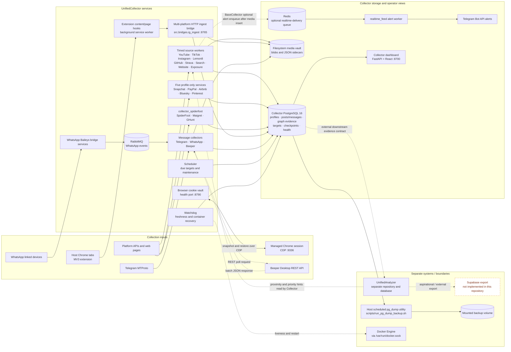
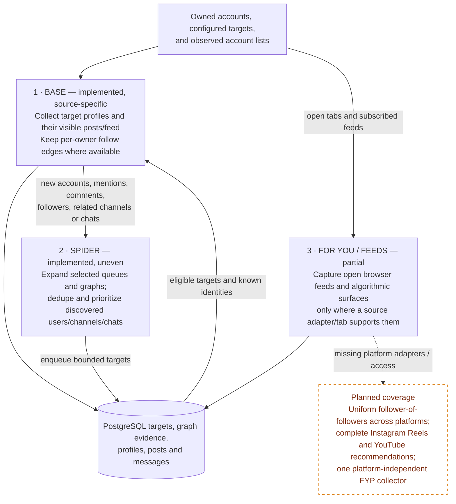
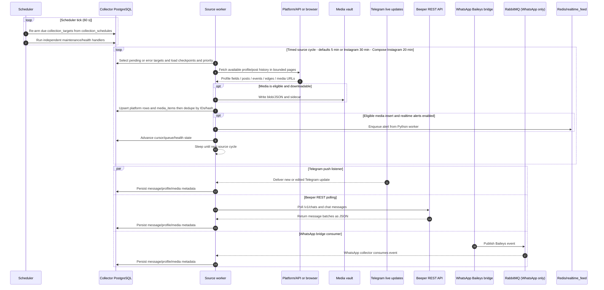

# UnifiedCollector architecture

This is a code-based architecture snapshot, reviewed 2026-10-13. It separates implemented behavior from the broader collection goal. “Backfill as far as possible” is a policy, not a promise of complete platform history: each source is bounded by its API, authentication, privacy rules, pagination, and configured limits.

## System map

**Boundary notes.** Docker Compose starts the Collector database, collectors, bridges, watchdog, scheduler, SpiderFoot recon service, browser cookie vault, brokers, realtime alert worker, and Collector dashboard. The watchdog uses `/var/run/docker.sock` for liveness checks and container recovery. The cookie vault listens on `:8790` and snapshots/restores the managed host Chrome session through CDP at `:9336`. UnifiedAnalyzer is a separate project; this repo does not start it or contain its downstream ingestion implementation. Collector code can optionally read Analyzer-owned proximity and collection-priority hints through `ANALYZER_DATABASE_URL` and cache them locally; the hints flow back to Collector workers when requested. The Collector dashboard reads Collector Postgres directly. No Supabase client, export job, or Supabase configuration was found in this repository, so the Supabase node is explicitly aspirational/external. The dashed Analyzer edge represents the downstream data contract, not a Collector-owned export process.

The WhatsApp event path is a brokered push path from external linked devices through internal Baileys bridge containers and RabbitMQ. Beeper is a worker-initiated REST polling source; it does not push events into the Collector. The browser extension uses a different path: logged-in pages are scraped by content/page hooks and POSTed to the aiohttp bridge, which writes into the same Collector database. The bridge retains the historical `ig_ingest` module name but accepts Instagram, TikTok, Lemon8, X, Threads, Facebook, and Strava payloads. Python workers enqueue optional realtime alerts to Redis after eligible media inserts; PostgreSQL does not enqueue alerts.

## Collection layers: philosophy and actual coverage

| Layer | Implemented behavior | Coverage boundary |
|---|---|---|
| **Base list** | `collection_targets` and source-specific target queues seed recurring collection. Account follower/following lists are stored as directional `follow_edges` where a source exposes them. The extension can collect Following feeds and per-profile content. | There is no single account-list importer or common completeness guarantee across every platform. A stable platform ID/handle and source-specific visibility/auth are the practical profile gate; most profile fields and post enrichment are optional. |
| **Spider expansion** | GitHub walks follower/following edges with a persistent queue. Instagram has a capped, two-hop browser spider plus headless graph collection. TikTok’s graph adapter follows outbound following lists where visible; follower enumeration is often unavailable. Strava records an owned athlete’s visible roster and queues athletes. Telegram discovers chats/groups from messages, forwards, and links. YouTube and Lemon8 also maintain queues for related/search/feed-discovered channels or users. | These are different discovery strategies, not one universal follower-of-followers implementation. Telegram chat discovery, YouTube related-channel queues, and Lemon8 author/tag discovery are not equivalent to follow edges. Famous-account caps, hop limits, queue caps, rate limits, and access failures narrow the graph. |
| **For You / recommendations** | TikTok has optional expanded `/foryou` and `/explore` tabs. X and Threads default to Following; an extension local-storage flag opts into a For You pass (roughly every fourth home-feed cycle). Lemon8’s topic page is scrapeable without login. Instagram collects per-profile Reels, stories, and highlights. | TikTok’s extra tabs are optional browser coverage, not a guaranteed FYP archive. Instagram per-profile Reels are not the personalized Reels recommendation feed. YouTube collects channels, videos, community posts and configured/search discoveries, not the home recommendation feed. There is no always-on, cross-platform recommendation collector. |

### Timed, backfill, and realtime paths

The timed worker loop is separate from the Scheduler. `src/worker/__init__.py` loads pending/error targets, runs a source collector, and sleeps between cycles. The code defaults to 300 seconds for most sources and 1,800 seconds for Instagram; Compose overrides Instagram to 1,200 seconds (20 minutes). `src/scheduler/__init__.py` ticks every 60 seconds, re-arms target rows whose schedule is due, then dispatches independent maintenance handlers. The Scheduler does not perform a universal backfill itself.

Backfill depth and realtime behavior are source-specific. Cursor/checkpoint and queue-based history collection exists in multiple collectors, but maximum age, page counts, item caps, API visibility and authenticated access differ. The worker marks Telegram, WhatsApp, and Beeper in `REALTIME_SOURCES` for quiet-source watchdog exemptions. Telegram and WhatsApp use event-driven paths; Beeper uses worker-initiated REST polling, not pushed events. The extension performs repeated browser passes while pages/tabs and sessions are available; it is not a platform-side event subscription. The `realtime_feed` service is an alert sidecar fed by Python workers after successful media inserts; it is not a collection listener, database trigger, or Supabase exporter.

## Persisted metadata and platform quirks

The common database contract is intentionally permissive. Normalized profile and post tables require a platform identity key (`platform_user_id`, `platform_channel_id`, `platform_post_id`, or username where that is the source key). `social_users` unions identities seen as authors, commenters, followers, tagged users, or profile targets; `follow_edges` retains the owner account and edge direction. `media_items` stores source/entity/content IDs, content type, path, size/dimensions, optional SHA-256, source URL and JSON metadata. Downloaded bytes go to the filesystem vault; a scraped post can exist without a downloaded media item.

The `media_items` table has required source/entity/content/path fields, while `source_url`, checksums, counts, captions, timestamps and many profile fields may be null. BaseCollector documents a preferred canonical `source_url`, but the database column is nullable. Inserts are idempotent on source/content ID and, for selected sources, media SHA-256. There is no repository-wide “rich post” score or rule that every post must have every metadata field. Collectors reject missing identity/content IDs and invalid/unavailable media according to source-specific parsers, permissions, and filters. **A profile’s identifier is generally required; bio, avatar, counts, location and verification fields are best-effort and may be absent.**

| Platform/source | Post, event, or content metadata persisted | Profile metadata and source-specific quirks |
|---|---|---|
| **Instagram** | `instagram_posts`: ID, media type, caption, hashtags/mentions, location, likes/comments/shares/saves, video duration/music, ad flag, created/collected times and raw JSON. Comments and media artifacts are separate. | `instagram_profiles`: platform ID, username/name, bio, follower/following/post counts, verified/private, photo and external URL. The schema’s email/phone fields are vestigial and Instaloader does not populate them. Geotags depend on the geotag setting; private/API visibility and session access constrain history. Headless collection and browser bridge coexist. |
| **TikTok** | `tiktok_posts`: ID, video/cover URLs, caption/description, tags/mentions/challenges, music/effects, duet/stitch flags, engagement counts, duration, create time and JSON. Comments and DMs have separate tables. | `tiktok_profiles`: ID/handle/nickname/avatar/bio, following/follower/heart/video/digg counts and verified/private. Browser discovery can expose data not available to the headless path; follower lists are often restricted. The FYP and Explore pages are optional extension tabs. |
| **Lemon8** | `lemon8_posts`: ID, title/description, image/video URLs, music, tags/mentions, location, engagement counts, time and JSON. | `lemon8_profiles`: ID/username/nickname/avatar/bio and follower/following/like counts. The public following graph is unavailable; “following” expansion is approximated from authors found in feeds/profile pages. Browser topic pages may be available without login; the headless collector handles broader discovery. |
| **YouTube** | `youtube_videos`: IDs, channel, title/description/tags/category/duration/definition/captions, engagement counts, publication time and processing status. Separate tables hold comments, transcripts and community posts. Media, comments and transcripts have independent retry/status fields. | `youtube_channels`: ID, title/description/custom URL, published time, thumbnail, view/subscriber/video counts, hidden-subscriber flag, country, keywords and external links. Hidden counts and unavailable transcripts/comments/downloads remain missing. Channel/search queues exist; personalized recommendations do not. |
| **GitHub** | Repositories, commits, issues, comments, pull request reviews and graph edges; commit rows include author/committer, message, date and change counts. | `github_users`: login/name/company/blog/location/email/bio, public repo/gist counts, followers/following and creation time. Public email is often absent. REST API quota and pagination bound both content and follower graph depth. |
| **X** | `x_posts`: post ID, author handle, text, hashtags/mentions, likes/replies/reposts/quotes/views, media type, timestamp and JSON from the browser page. | `x_profiles`: platform ID or handle fallback, username/display name, bio, counts, verification/privacy, avatar, external URL, location and joined text. Browser DOM visibility is best-effort; a hidden numeric ID may fall back to the handle. For You is opt-in. |
| **Threads** | `threads_posts`: ID, author, text, tags/mentions, likes/comments/reposts, media type, timestamp and JSON from visible browser pages. | Author/user observations and profile fields are browser-derived and less complete than Instagram’s normalized API profile. Following is default; For You passes require opt-in. |
| **Facebook** | `facebook_posts`: ID, author, text, tags/mentions, likes/comments/shares, media type, timestamp and JSON from the visible page. | Browser profile probe stores ID/handle, display name, bio, follower/following/friend counts, person flag, avatar, external URL and JSON. DOM visibility and privacy settings can omit fields. |
| **Strava** | `strava_activities`: activity type/name/description, distance/time/elevation/speed, heart rate/cadence/power/calories, date/timezone and coordinates; GPS streams, photos, kudos and comments are separate. The extension can capture route/stream data from browser pages. | `strava_athletes`: ID, name/username, profile image, city/state/country/sex/height/weight and follower/following counts. Cookie/auth scope limits profile/history access. Privacy zones may hide or offset GPS; stream endpoints have cooldown/rate limits. |
| **Telegram** | Chats, users and `telegram_messages`: IDs, sender/chat, text/caption/media type, reply/edit/forward/bot metadata, platform time and JSON; separate tables capture members, mentions, locations and other message events. | `telegram_users`: platform ID, username/name, phone and bio/photo/deletion state when visible. Phone is not universally exposed. Telethon backfills available chat history and then listens for new/edit events. |
| **WhatsApp** | Chats/users/messages include chat and sender IDs, text, media URL/MIME/size/thumbnail, quoted/forwarded fields, timestamps/status and JSON. Group/participant and link evidence are separate. | Name/push name/phone/business/status/photo/about are optional. Linked-device IDs (`@lid`) can differ from phone JIDs and are mapped separately. Baileys bridge events pass through RabbitMQ to the collector. |
| **Beeper / Matrix** | Shadow account/chat/message tables retain network, sender, message type/text, timestamp, edits/deletions, attachments, reactions, read/unread state, and raw payload. | Beeper account and participant metadata include network/login/display name and available email/phone/avatar. It is a mirror/backstop for native Telegram/WhatsApp; do not add those mirrored counts to native counts. The dashboard treats Beeper as canonical for Discord, Slack, LinkedIn, Signal, Instagram DMs, and Beeper-only rooms. |
| **Search** | Query, result URL/title/snippet/rank/domain/publication date and collected time. | No source profile table. Search discovery is a seed for later URL/domain/account collection, not a social profile source. |
| **Website** | Page URL/hash, title/meta fields, H1, extracted text/HTML, internal/external links, images, structured data, HTTP status and fetch time. | No source profile table. Per-domain pacing, URL filters and timeouts constrain crawl depth; extraction is mostly I/O-bound. |
| **Exposure / recon** | Findings include target scope/query, URL/domain, category/severity/confidence, title/snippet, detected-secret indicator and JSON. | No normalized social profile or post table. SpiderFoot/Maigret/GHunt are scoped enrichment; results are observations, not automatically confirmed identity links. |
| **Snapchat** | **No posts collected.** | Profile probe records username, display name, Bitmoji URL/version and Snap score when present. HTML/serialized payload changes or challenge pages may make the probe inconclusive. |
| **PayPal** | **No posts collected.** | Profile probe records username, display name, avatar, PayPal.Me currency and business flag. Public page/HTML structure controls field availability. |
| **Airbnb** | **No posts collected.** | Profile probe records display name, avatar, host-since date, Superhost flag, city, listing count and review count. Serialized page fields and anti-bot/CAPTCHA responses can suppress results. |
| **Bluesky** | **No posts collected by this profile-only probe.** | AT Protocol profile probe requires a DID and records handle, display name, description, avatar, follower/following/post counts and indexed time. |
| **Pinterest** | **No posts collected.** | Profile probe records display name, bio, avatar, follower/pin/board counts. Username-to-Gmail is only emitted as a low-confidence discovered-link heuristic, not verified email. |

The five profile-only services are queue-driven, rate-limited probes. They write one platform profile row per successful username and mark not-found/error status; they do not download media or build a spider queue.

## Scheduling, health, and recovery

- **Worker supervision:** `src/worker` supervises source tasks, staggers cold starts, detects crashes/hangs/zero-progress runs, and rebuilds collector instances on retry. Docker restart policy is the final process-level recovery.
- **Scheduler:** the single scheduler service runs the due-target rearm and periodic handlers. `FOR UPDATE SKIP LOCKED` avoids duplicate schedule claims; independent handlers are dispatched concurrently with per-handler failure isolation.
- **Watchdog:** `src/watchdog/freshness.py` checks source freshness, browser/DM heartbeats, dead-letter work, and Docker liveness. It can start stopped containers and restart stale collectors, with source-specific cooldowns and deferrals for auth, 429, or bridge pairing states.
- **Browser sessions:** `src/tools/browser_cookie_vault.py` listens on port 8790, snapshots managed Chrome cookies through CDP every five minutes, and can restore authenticated sessions.
- **Reliability state:** `source_health`, `collection_targets`, `collection_runs`, checkpoint/queue tables and `dead_letter_queue` expose progress, retry, and operational state to the dashboard.

## Backup, notifications, and downstream boundaries

- **Database backup — implemented, host-scheduled.** The deployed Linux launcher runs from the host’s scheduled task, builds a small PostgreSQL utility image, and starts a one-shot container on the Compose network. `scripts/pg_dump_backup.py` uses a custom-format, single-job, low-compression dump, an advisory lock, a freshness skip, temporary-file verification with `pg_restore --list`, then retention. It writes to the mounted backup volume. There is no always-on Compose `backup` service.
- **Media sidecars — implemented.** `BaseCollector` writes media files to the vault and JSON sidecars; the database stores file paths, hashes and provenance. This is separate from the Postgres logical backup.
- **Realtime notification sidecar — implemented but optional.** After a successful `media_items` insert, BaseCollector's Python code can enqueue an alert to Redis without blocking collection; `realtime_feed` drains that queue and delivers configured alerts. This is downstream notification, not a database trigger or analyzer data export.
- **Analyzer — external consumer.** UnifiedAnalyzer lives in another repository and owns identity resolution and analysis. This repo contains schema/provenance intended for that consumer and an optional reverse pull of Analyzer priority/proximity hints. It does not launch the Analyzer or implement a general outbound row exporter.
- **Supabase export — aspirational/external.** No exporter, Supabase SDK usage, or Supabase env wiring exists in this repo. Add an independently owned export mechanism only when the Analyzer-side contract and ownership are defined.

## Efficiency review

This is a static code review, not a live throughput or database benchmark. The bottlenecks below are structural risks visible in the code; actual ranking depends on current platform quotas, target mix, and media volume.

### Applied fixes and remaining risks

The four approved efficiency workstreams from commit `93d14759` are **done**:

- Instagram, TikTok, and Lemon8 share the `shared_social` advisory lock so their scrape requests do not overlap on common public egress.
- TikTok gallery-dl artifacts stream from their temporary file into the vault through `write_atomic_artifact_from_path`; the whole video is no longer loaded into Python memory first.
- Browser media candidate and revisit writes are batched, and X/TikTok/Lemon8 profile-target enqueues are batched instead of issuing one round trip per handle.
- Freshness and browser raw-archive DLQ lookups have source-first/partial indexes, and the archive cleanup uses its matching selective index.

The efficiency audit also identified remaining pressure points. These are risks to measure or evaluate, not work included in the approved fixes:

| Area | Concrete finding | Status and practical impact |
|---|---|---|
| **Profile-probe containers** | Compose still runs five 192 MiB profile-only services (960 MiB reserved in total), while `profile_only_runner.py` can run all five sources in one process. | Consolidation was excluded from the approved changes. The separate services isolate stalls, but retain the extra memory limits, processes, and database pools. |
| **Bridge post writes** | `_save_posts()` still resolves Instagram authors through per-post profile lookups/inserts and then inserts posts one at a time. | Candidate/revisit and profile-target batching is done; this separate author/post loop remains sequential and can add round trips on large browser batches. |
| **Global PostgreSQL pool budget** | The audit estimated a theoretical 220–250 application connections across active pools against PostgreSQL's configured ceiling of 200. | This is a peak-capacity estimate, not evidence of observed saturation. Pool caps are per process, so measure combined live pool demand before raising any cap. |
| **Browser and container memory** | Instagram Playwright collection launches isolated Chromium processes per profile/post operation, while the separate cookie-vault service manages host Chrome sessions. Five profile workers and other capped services can also peak together. | The audit flags potential browser churn and host memory contention. The cookie vault does not make the Instagram worker reuse its browser process. |
| **Other database polling paths** | WhatsApp and Beeper backfill write messages sequentially; SpiderFoot can poll every 0.5 seconds while a target is active. | These paths were not part of the approved bridge batching change. Measure query and queue rates before batching or changing poll intervals. |

| Area | Likely cost / pressure point | Existing controls and optimization |
|---|---|---|
| **Remote API / session limits** | Instagram/TikTok/Strava access can be throttled or hidden; GitHub REST quota is explicit; YouTube extraction has request/download limits; Telegram can return FloodWait. Crawling graph neighbors multiplies calls. | Per-source pacing, adaptive cooldowns/rate-limit events, API quota accounting, retries/circuit breakers, famous-account and queue caps, and source-specific cycle intervals. The Instagram/TikTok/Lemon8 shared lock is implemented; other source groups may still contend. |
| **Backfill vs fresh collection** | Large historical scans compete with current targets for API quota, sockets, host memory and database writes. “All history” is not a single shared mode and remote history may be inaccessible. | Per-source page/batch/pass limits and queues/checkpoints; separate containers isolate process failures and permit per-source resource limits. Realtime messaging sources are exempt from zero-progress alarms when quiet. There is no global cross-platform quota arbiter, so independent services can still contend. |
| **Media and vault I/O** | Downloading video/photos, writing blobs and sidecars, hashing bytes, and source URL/metadata bookkeeping dominate I/O. YouTube `yt-dlp`/ffmpeg and browser media upload are heavier than metadata-only rows. | Media type/size filters, bounded download concurrency, stable IDs, atomic writes, SHA-256 deduplication, partial media revisit queues, and a shared filesystem vault. TikTok gallery-dl path streaming is implemented, avoiding a full-file Python bytes allocation. YouTube is isolated in its own worker container; media paths have retry/status state. |
| **Shared PostgreSQL** | All collector workers, bridges, dashboard, scheduler and realtime consumers share one Collector database. Per-media success can involve an insert plus sidecar/consistency metadata and queue-ledger updates; bulk dumps add storage reads and can delay DDL/migrations. | The `(source, collected_at DESC)` index supports per-source freshness lookups. A partial `(source, entity_id)` DLQ index narrows active browser raw-archive cleanup. Browser candidate/revisit rows and X/TikTok/Lemon8 profile-target enqueues are batched; `ON CONFLICT` preserves idempotency. Other controls include bounded per-process pools, `SKIP LOCKED` queue claims and singleton advisory locks. Host dumps use one job and compression level 1. |
| **CPU / memory** | Parsing is generally small next to network waits, but video extraction/transcoding, image analysis, browser processes, and SpiderFoot/Maigret can use substantial CPU/RAM. Many isolated containers can still peak together on cold start. | Resource caps, startup staggering, one-worker SpiderFoot default, YouTube process isolation, async network I/O, and worker recovery limit individual failures. The separate profile services and Instagram Playwright process churn remain sources of host pressure. |
| **Dashboard/ops queries** | Freshness, coverage, target and graph views can scan large tables if indexes or query bounds are missing; operational pages compete for the same DB pool. | Dedicated lookup/partial indexes, cached coverage/health snapshots, bounded limits and a separate connection pool configuration. Confirm with query plans under real data before further denormalizing. |

### Efficiency priorities

1. **Done in `93d14759`:** enforce the shared social mutex, stream TikTok gallery-dl files from disk, batch browser candidate/revisit writes and profile-target enqueues, and add source-first freshness plus selective DLQ indexes.
2. **Deferred:** decide whether to consolidate the five profile-only services; the runner supports it, but the separate services currently isolate failures and consolidation was outside the approved scope.
3. **Measure before changing limits:** compare combined live application-pool demand with PostgreSQL's 200-connection ceiling and record DB write latency, queue age, and media bytes by source.
4. **Review remaining hot paths:** Instagram author/post inserts, per-message WhatsApp/Beeper writes, and Instagram Playwright process startup remain candidates for measured optimization.
5. Keep history/backfill bounded around current realtime load and treat recommendation-feed or graph expansion as explicit coverage work with quotas and eligibility caps.

## Code map

- `src/collectors/` — source-specific fetch, parsing, backfill, and profile/post persistence.
- `src/worker/__init__.py` — timed source loop and in-process supervision.
- `src/scheduler/` and `src/watchdog/freshness.py` — due-target scheduling, periodic work, freshness/liveness recovery.
- `src/tools/browser_cookie_vault.py` and `src/recon_spiderfoot_service.py` — managed Chrome cookie snapshots and the SpiderFoot/Maigret/GHunt recon service.
- `extension/src/content.ts`, `extension/src/inject.ts`, `extension/src/background.ts` — browser capture and delivery.
- `src/bridges/ig_ingest/` — multi-platform browser ingest API, profile/post/edge upserts, target queues.
- `src/bridges/whatsapp/`, `src/collectors/whatsapp/` — Baileys event producer and RabbitMQ consumer.
- `src/db/schemas/`, `src/db/migrations/` — Collector data and operational tables.
- `src/dashboard/` — Collector operations API and SPA.
- `scripts/run_pg_dump_backup.sh`, `scripts/pg_dump_backup.py` — host-scheduled database backup path.
